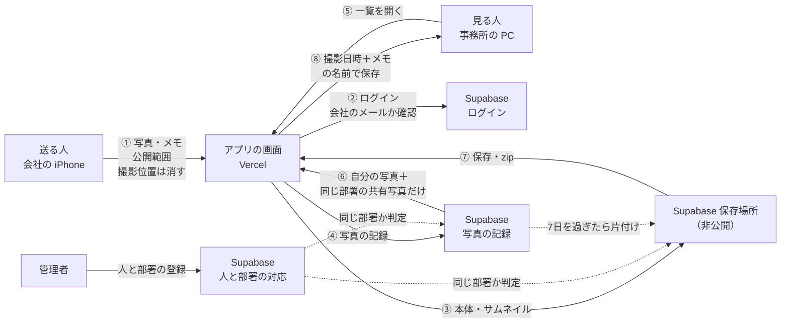

# 写真共有アプリ 要件定義書（第2版・練習版）

> 架空のデータで作る。社名・個人名・実データは書かない。

## 1. 目的・困りごと
- 要望：携帯で撮った写真を、パソコンに簡単に移したい。
- 困りごと：会社の携帯で撮った試験片や現場の写真を、毎回メールに添付して自分宛てに送っている。1回に10分ほどかかる（架空の目安）。特に次の4つが不満。
  - 枚数が多いと何通にも分けて送ることになる
  - 届いたメールを開いて、1枚ずつ保存する
  - 保存後にファイル名を付け直し、どの写真か見分ける
  - メールが届くまで待つ
- 写真の行き先：パソコンへの保存、当日の日報、部会資料の3つ。
- 本当の目的（要求）：行き先に関係なく、撮った写真をまずパソコンへすぐ集めること。長期保管はこのアプリの役割ではない（保存先のフォルダや日報側で保管する）。

## 2. 使う人
- 複数の部署の社員が、部署ごとに分けて使う。会社のメールアドレスを持つ人だけ。
- ペルソナA（架空）：技術系の部署の試験担当。試験室で iPhone を使い、試験片を1回に5〜20枚撮る。その日のうちに日報に貼り、週1回の部会資料にも使う。一番の不満は、メールを何通にも分けて送ること。
- ペルソナB（架空）：製造系の部署の現場担当。現場で設備や製品を撮り、事務所に戻ってから自分のパソコンで報告書に貼る。パソコン操作に慣れていないので、ボタンが少なく迷わない画面がよい。

## 3. 機能
1. ログイン：会社のメールで最初に1回ログインし、あとはその iPhone・パソコンでログインしたまま使う。会社以外のメールではログインできない。
2. 送る（スマホ向け）：写真を撮る、または選ぶ（1回に複数枚）。メモ（任意）を付け、「自分だけ」か「部署で共有」を選んで送る。送る前に写真を縮め、撮影日時は縮める前に読み取っておく。
3. 見る（パソコン向け）：自分の写真と、同じ部署で共有された写真を、新しい順に一覧で表示する。送ったらすぐ一覧に出る。
4. 保存：1枚ずつ、または選んだ写真をまとめて zip で保存する。ファイル名は「撮影日時＋メモ＋連番」で自動で付く（例：`20261021_1430_試験片A_01.jpg`）。メモが空なら日時と連番だけ。ファイル名に使えない記号は自動で置き換える。
5. 片付け：送ってから7日を過ぎた写真を、アプリから自動で消す。パソコンに保存したものは残る。

## 4. 扱うデータ
| 表 | 項目 |
|---|---|
| 写真の記録 | 写真ID／送った人のメール／公開範囲（自分だけ・部署で共有）／部署／撮影日時／メモ／送った日時／本体とサムネイルの場所 |
| 部署 | 部署ID／部署名 |
| 人と部署の対応 | メールアドレス／部署ID（管理者が Supabase の表に直接書き込む） |
| 写真ファイル | 本体（縮めたもの）とサムネイル。非公開の保存場所に置く |

例（架空・5件）
| 撮影日時 | 送った人 | 部署 | 公開範囲 | メモ |
|---|---|---|---|---|
| 2026/10/21 14:30 | user-a@mock.example | 部署A | 部署で共有 | 試験片A |
| 2026/10/21 14:31 | user-a@mock.example | 部署A | 部署で共有 | 試験片A |
| 2026/10/20 09:10 | user-b@mock.example | 部署B | 自分だけ | 設備1 |
| 2026/10/18 16:00 | user-c@mock.example | 部署A | 自分だけ | （なし） |
| 2026/10/16 11:20 | user-b@mock.example | 部署B | 部署で共有 | 製品サンプル |

## 5. 誰が何を見られるか
| 役割 | 見られるもの | できること |
|---|---|---|
| 送った本人 | 自分が送ったすべての写真 | 送る・保存する |
| 同じ部署の人 | 「部署で共有」の写真だけ | 保存する |
| 別の部署の人 | 何も見られない | — |
| 会社以外のメールの人・ログインしていない人 | 何も見られない | — |
| 管理者（Supabase の Owner 権限） | 人と部署の対応の表 | 部署の登録・変更 |

## 6. 非機能要件
| 項目 | 内容 |
|---|---|
| 使いやすさ | スマホのボタンは指で押しやすい大きさ。送るまで3タップ程度。エラーは「何が起きたか」と「次にすること」の2文で出す |
| 性能 | 1枚の送信は数秒以内（縮めてから送る） |
| 可用性 | 業務時間中に使えればよい。止まったときは部署の担当者が確認する |
| セキュリティ | 保存場所は非公開。部署の外からは見えない（データベースの行単位の権限で判定する）。撮影位置などの情報は縮めるときに消える。接続キー・会社のドメインはコードに書かない |
| 運用・保守 | 部署で維持・保守する。変更はプルリクエストで残す |
| 移行 | 今あるデータの移し替えはない。練習版から実データ版へは設定の切り替えで移る |

## 7. 作らないもの（第1版）
- 写真の編集（切り抜き・書き込み）
- 部署の登録画面（管理者が表に直接書き込む）
- 1週間を超える保管、フォルダ分け
- 送ったことの通知（メール・チャット）
- AI による写真の判定
- 練習版での実データの扱い（架空のテスト画像のみ）

## 8. 完了の条件
- iPhone で送ると、パソコンの一覧にすぐ出る
- 「撮影日時＋メモ＋連番」の名前で、1枚保存とまとめて保存ができる
- 別の部署の人には「部署で共有」の写真が見えない。「自分だけ」の写真は本人にしか見えない
- 送ってから7日を過ぎた写真は一覧に出ず、消える
- 接続キー・会社のドメイン・個人名が GitHub のコードに入っていない

## 付録：データの流れ図

